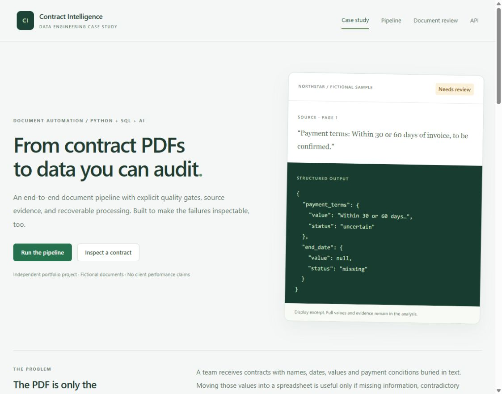
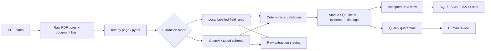

# AI Contract Intelligence

[](https://github.com/Henrxque/ai-contract-intelligence/actions/workflows/tests.yml)

**Engineering case study: contract PDFs → extraction → quality gates → SQL → review and delivery.**

A reproducible document data pipeline with content-addressed ingestion, raw extraction staging, normalized SQL output, bounded recovery, and a measured synthetic benchmark. The browser interface makes the engineering inspectable: every field carries evidence, missing information remains `null`, and uncertainty survives delivery.



[Português](README.pt-BR.md) · [Case study](docs/CASE_STUDY.md) · [Architecture](docs/ARCHITECTURE.md) · [Runbook](docs/RUNBOOK.md) · [Verification](docs/VERIFICATION.md) · [MIT license](LICENSE)

## The engineering story

A team needs usable contract data, including exceptions that extraction cannot safely resolve. This project demonstrates the workflow with fictional documents; it does not claim employer code, client outcomes, or measured production accuracy.

| Capability | Executable proof |
| --- | --- |
| Ingestion and identity | PDF SHA-256; run identity includes mode, model, prompt/label hash, policy hash and pipeline version |
| Raw and normalized layers | PDF bytes, page text and typed extractor output; separate fields, evidence and findings tables |
| Idempotency | Repeat a successful batch with the same configuration: reuse results without new attempts |
| Recovery | Explicit retry/resume, five-minute worker leases, stale-worker fencing and a three-attempt limit |
| Data quality | Required fields, values, dates, evidence checks and accepted/quarantine SQL views |
| Evaluation | Eight synthetic PDFs, 88 independently authored expected field values, per-field mismatch report |

**Measured local baseline:** 76/88 field values matched (86.4%); non-null value recall was 74/86 (86.0%). Eleven fields were missed in the narrative contract and one wrapped payment condition was incomplete and flagged uncertain. No incorrect or ungrounded value was marked supported on this corpus. These are development-fixture results from local rules, not live LLM or real-world accuracy measurements. [Full report](app/benchmark/local-report.json).

## What you can do

- Upload a selectable-text PDF and extract parties, dates, contract value, currency, payment terms, and clauses.
- Inspect a source quote and page reference for every extracted value.
- Review missing required fields, optional gaps, conflicting candidates, uncertain wording, invalid dates, negative amounts, and unverifiable evidence.
- Export the full JSON analysis, a CSV, or an Excel workbook with fields, findings, and extraction metadata.
- Try three **fictional PDF contracts**, processed through the actual reader and validation pipeline.
- Use **local rules without an API key**, or enable **OpenAI structured extraction** for varied document wording.

No accounts or external database service are required. The batch pipeline persists to local SQLite; single-document review remains transient.

## Run locally

Requires Python 3.11 or later. The implementation was verified locally with Python 3.14.3.

```powershell
git clone https://github.com/Henrxque/ai-contract-intelligence.git
cd ai-contract-intelligence
python -m venv .venv
.venv\Scripts\python -m pip install -r requirements.lock
.venv\Scripts\python -m pip install --no-deps -e .
.venv\Scripts\python -m uvicorn app.main:app --host 127.0.0.1 --port 8000
```

Start with **http://127.0.0.1:8000/case-study** for the engineering presentation, then **http://127.0.0.1:8000/pipeline** to process and replay a batch. Single-document review remains at **http://127.0.0.1:8000/**. API reference: `/docs`; machine-readable schema: `/openapi.json`.

On macOS/Linux, use `.venv/bin/python` in place of `.venv\Scripts\python`.

### Enable LLM extraction

Copy `.env.example` to `.env` and configure it locally:

```dotenv
OPENAI_API_KEY=your-key-here
OPENAI_MODEL=gpt-4.1-mini
ENABLE_OPENAI=true
```

Restart the server, select **LLM extraction**, and acknowledge the document-text transmission before analyzing an upload. API usage is billed by the provider. Never commit `.env` or share real client documents in a portfolio demo.

The adapter uses the [OpenAI Responses API with Pydantic structured outputs](https://developers.openai.com/api/docs/guides/structured-outputs). It requests `store=False`, retains page markers, treats document content as untrusted input, and exposes specific errors for quota, authentication, timeouts, and incomplete responses. Provider data policies still apply.

The LLM path has automated **mocked adapter tests**. A paid, live-provider extraction has **not** been run as part of the local verification. Do not interpret the local demo as a live LLM result.

## Try the three review scenarios

| Contract | What it demonstrates | Expected result |
| --- | --- | --- |
| Northstar | Missing end date, missing optional governing law, ambiguous payment deadline | Needs review |
| Meridian | All eleven configured fields explicitly present | Checks passed |
| Atlas | End date before start, negative amount, ambiguous currency, conflicting payment terms | Needs review |

All entities, amounts and clauses are synthetic. The samples contain no employer or customer data and are not legal templates.

### Understand the field states

| State | Meaning |
| --- | --- |
| `supported` | Field format passes checks; evidence exists on the claimed page; value corresponds to the quote. |
| `missing` | No explicit value was extracted. Required gaps block passing checks. Optional gaps remain visible. |
| `uncertain` | Ambiguous wording, conflicting candidates, ambiguous date convention, or unsupported/unverified evidence. |
| `invalid` | A deterministic rule failed: malformed date, negative amount, invalid currency, or reversed date range. |

**“Checks passed” is scoped to the configured checks.** It does not guarantee complete extraction, correct interpretation, enforceability, or legal validity. There are no invented confidence percentages. Required fields are a configurable extraction policy, not a claim about legal requirements.

## Local baseline versus LLM

The local baseline matches supported English/Portuguese labels followed by `:` and a value on the same line, such as `Client: Harbor Retail Group Inc.` or `Contratante: Empresa Exemplo Ltda.` It is useful for reproducible demos and structured templates. It is **not a general contract language parser**. Unrecognized labels, columns and wrapped values may be missed or incomplete; likely qualification continuations are flagged, but detection is not exhaustive.

LLM mode can handle varied phrasing and longer clauses. Its output is still checked deterministically. Evidence matching proves text correspondence, not the truth or completeness of an interpretation. A model can fail to identify a field or a conflict, so human review remains necessary.

PDF text extraction uses [pypdf](https://pypdf.readthedocs.io/en/latest/user/extract-text.html). Scans without usable text return `ocr_required`; OCR is outside this version's scope. A mixed text/scan PDF is marked for review when a page has no text.

## Reproduce the pipeline and benchmark

```powershell
# Persist all 8 fictional PDFs to a dedicated local database.
.venv\Scripts\python -m app.cli batch app/samples --synthetic --database data/demo.sqlite3 --output data/first-batch.json
# Same inputs + configuration: cached results, no new successful-run attempts.
.venv\Scripts\python -m app.cli batch app/samples --synthetic --database data/demo.sqlite3 --output data/repeated-batch.json
.venv\Scripts\python -m app.cli inspect --database data/demo.sqlite3
# Evaluation uses the shared engine and writes no document database.
.venv\Scripts\python -m app.cli evaluate --output data/evaluation.json
```

`python -m app.cli retry RUN_ID --database data/demo.sqlite3` resumes queued/expired runs or retries failures. A changed configuration requires a new batch. Review findings do not count as processing failures. The CLI exits nonzero when a batch contains processing failures.

Batch limits: ten files, 10 MB combined; each PDF may have at most forty pages and 120,000 extracted characters. Batches are sequential. Inputs are registered before execution so queued runs remain recoverable after interruption. The workflow is request/CLI driven, not an autonomous scheduler.

Expected answers are authored in [the fixture builder](scripts/build_benchmark.py), independently of extraction. [The frozen manifest](app/benchmark/ground-truth.json) pins each PDF's hash. This development corpus deliberately includes failures; it is not an unseen evaluation set. Exact match tolerates case and whitespace differences only. See [metric definitions](docs/CASE_STUDY.md).

## Tests

```powershell
.venv\Scripts\python -m pip install -r requirements-dev.lock
.venv\Scripts\python -m pytest -q
```

Tests cover extraction, quality, PDFs, provider failures and export safety, plus database round trips, duplicate submissions, concurrent claims, expired-worker fencing, transactional rollback, retries, CLI execution and evaluation integrity. GitHub Actions passed all 86 tests on Ubuntu with Python 3.11, 3.13 and 3.14 and uploaded an evaluation artifact for each version. [Verified CI run](https://github.com/Henrxque/ai-contract-intelligence/actions/runs/44801053478).

## Architecture



**Stack:** Python · SQLite · FastAPI · Pydantic · pypdf · OpenAI SDK · openpyxl · vanilla HTML/CSS/JavaScript · pytest. The browser UI has no build step, external fonts, trackers or runtime CDN dependencies.

```text
app/
  main.py          HTTP routes and orchestration
  analysis.py      Shared extraction engine and checkpoints
  pipeline.py      Batch orchestration and configuration identity
  storage.py       SQL persistence, transitions, leases and atomic completion
  cli.py           Batch, retry, inspect and evaluate commands
  evaluation.py    Independent comparison and metric aggregation
  pdf.py           PDF reading and input limits
  extractors.py    Local baseline and optional OpenAI adapter
  validation.py    Evidence grounding and deterministic checks
  models.py        Typed extraction and result schemas
  exports.py       JSON, CSV, Excel and formula escaping
  static/          Responsive review UI and API reference
  samples/         Eight fictional PDFs; three also appear in the review demo
  benchmark/       Frozen ground truth and measured baseline report
  sql/             Initial schema and accepted/quarantine views
scripts/           Sample generation and dependency freezing
tests/             API, validation and mocked-provider tests
docs/              Architecture, verification and screenshots
```

## Data handling and deployment scope

This is a **local portfolio application**. Single-document review (`/api/analyze`, `/api/demo`) does not persist document history. Batch mode saves PDF bytes, page text, typed extractor output, normalized results and history to `PIPELINE_DB_PATH` (default `data/pipeline.sqlite3`). Browser uploads require persistence consent; LLM batches also require provider-transmission consent. The CLI batch command intentionally persists inputs. Runtime databases and outputs under `data/` are ignored by Git. The framework can spool uploads temporarily. Exports include source text if the input contains it.

Local mode makes no AI-provider calls. LLM mode sends extracted text to OpenAI, with provider policies applying. Server validation errors do not echo submitted contract content or raw provider error details. CSV and Excel cells are escaped to prevent formula execution.

Two analyses can run at a time per process; batches are sequential. The pipeline allows three attempts per run, with an additional SDK retry possible inside an OpenAI attempt. A crash after a provider request but before commit can cause another charge when retried: output deduplication does not guarantee exactly-once billing. These controls are not a sandbox for hostile PDFs. Public use needs authentication, upstream limits, rate limits, isolated PDF workers, cost controls and a retention policy. There is no OCR, signature validation, legal advice, field-editing workflow or automated business decision-making.

A `Dockerfile` is included for packaging, but its image has not been built in the verified local environment. For a local container, keep the host port on loopback:

```sh
docker build -t ai-contract-intelligence .
docker run --rm -p 127.0.0.1:8000:8000 ai-contract-intelligence
```

## Repository

Public source: [Henrxque/ai-contract-intelligence](https://github.com/Henrxque/ai-contract-intelligence). The default branch is `main`.

The repository contains the source, synthetic fixtures, measured evaluation, screenshots, SQL examples and CI workflow. The running web demonstration remains local; GitHub publication does not deploy the application.

This repository demonstrates document automation and review-system engineering. It makes no claims about employer code, proprietary workflows, customer outcomes, or measured accuracy on real contracts.
