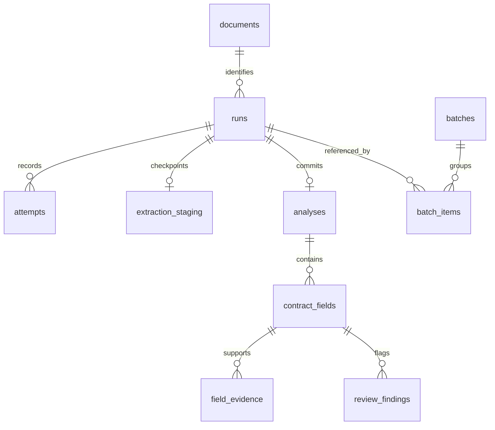

# Architecture and validation policy

## Durable batch workflow (v0.2)

`app.analysis` is the shared engine for individual review, the batch pipeline and evaluation. `app.pipeline` registers inputs and orchestrates execution; `app.storage` owns short SQL transactions and run ownership. `app.cli` exposes batch, retry, inspect and evaluate commands. `app.pipeline_api` exposes the same capabilities to the browser.

The batch workflow deliberately stores original PDFs and processing data in SQLite. Individual review endpoints remain transient. The browser requires explicit batch-persistence consent and a separate consent for OpenAI transmission.

PDF hashes deduplicate input bytes. Run identity includes the pipeline version, extraction mode, model, prompt/label hash, policy hash and synthetic-source flag. API keys and enablement flags are excluded so credentials can be corrected before retry. Bump `PIPELINE_VERSION` after semantic changes not otherwise covered by the fingerprint.

All batch inputs are registered before processing. A short `BEGIN IMMEDIATE` transaction grants a unique five-minute lease and increments the attempt count. Another active claimant receives `in_progress`. After expiration, a new claimant closes the old attempt and receives a different token. Checkpoints and completion verify the token and its unexpired lease; stale workers cannot overwrite accepted output. Each run permits three attempts. This is explicit recovery, not a scheduler or exactly-once provider-call guarantee.

Successful completion inserts analysis, fields, evidence and findings and updates the run/attempt in one transaction. A failure rolls back all normalized writes. Separately committed raw staging remains inspectable. Staging retains the latest payload for a run; attempts retain status and error history.

`accepted_contract_fields` includes supported fields only from completed contracts whose configured checks passed. `quality_quarantine` includes all fields from completed contracts requiring review. Processing failures have no `analyses` record. Quality findings therefore do not imply execution failure.

Batch items preserve the state observed when processed; API history also reports the current run state after later retries. Original filename and batch aliases are retained separately. SQLite foreign keys are enabled on every connection; WAL permits short reads alongside writes. The initial SQL schema is versioned in `app/sql/001_pipeline.sql` and recorded in `schema_migrations`.

The evaluation manifest pins eight fictional PDF hashes and separately authored answers. It compares values/statuses without trusting model confidence, reports both numerators and denominators, and retains mismatches. It is a development benchmark, not evidence of real-world generalization. See the case study for the measured baseline and definitions.

## Request lifecycle

1. The browser sends one multipart PDF with an explicit extraction mode.
2. The API reads up to the 10 MB limit plus one byte and closes the uploaded file.
3. `pypdf` extracts page-numbered text after signature, encryption, page-count and complexity checks.
4. An extractor produces the same typed `Extraction` schema in either mode.
5. Deterministic rules create `ReviewField` records and findings.
6. Individual review returns the result without persistence; batch mode commits it to SQLite.
7. Export requests transform a submitted result into an attachment.

The local sample endpoint reads checked-in fictional PDFs and goes through the same extraction and validation functions. It does not return a canned extraction JSON.

## Extraction schema

Each of eleven fields has `value`, `evidence`, `uncertain`, and `reason`. Evidence includes a verbatim quote and one-based page number. Absent fields use `null` rather than empty strings, zeros or guessed values.

Parties are explicitly assigned provider/client roles. Contract fields include effective date, end date, value, currency, payment terms, governing law, termination, confidentiality and liability. Clauses remain text; there is no legal risk score.

The response also contains a PDF SHA-256, schema version, timestamp, extraction mode, provider model when used, duration, sample flag, source pages, findings and notices. A hash identifies the input bytes, not the authenticity of a contract.

## Deterministic checks

- Required: provider, client, effective date, end date, value, currency, payment terms. These are project policy choices in `FIELD_SPECS`.
- Optional: governing law, termination, confidentiality, liability. Missing optional fields create informational findings.
- Dates: real calendar dates; ISO or explicit month names; numeric dates accepted only when their convention is unambiguous. The end cannot precede the start.
- Amounts: normalized using `Decimal`, non-negative, bounded, and at most two decimal places. Ambiguous separators are rejected. No sums or currency conversion are inferred.
- Currency: recognized explicit ISO code or an explicitly mapped currency name. A dollar symbol alone is insufficient.
- Evidence: case/whitespace/Unicode-normalized quotes must appear on the claimed source page. Field values must correspond directly to the quote; supported date, amount and currency normalization is handled separately.
- Extractor uncertainty always survives validation. Matching evidence does not remove ambiguity.
- A textless page makes the overall result `needs_review`, even if all configured fields passed.

These checks can reject invented or unsupported values. They cannot establish that a model found every field, interpreted a clause correctly, resolved all conflicts, or extracted every page completely. Conflicts in the local mode are detected when different values use the same supported label; arbitrary prose conflicts may go undetected.

## Provider adapter

The OpenAI adapter uses `AsyncOpenAI.responses.parse` with the Pydantic extraction model. It uses `store=False`, page markers, a dedicated extraction instruction, a 60-second request timeout, at most one SDK retry, and a 90-second overall budget. Documents are treated as untrusted data. No tools are exposed to the model.

A refusal or absent parsed output is an error rather than a successful empty extraction. Authentication, quota, connectivity, timeout and malformed response failures are translated to actionable codes without exposing raw provider responses. Mocked tests verify adapter behavior; they do not measure actual model quality.

## Export contract

JSON retains the complete response, including `null` values. CSV carries fields, statuses, issues, evidence, and appended extraction metadata. Excel has three sheets: extracted fields, review findings, extraction metadata. Spreadsheet cell values that could be interpreted as formulas are prefixed with an apostrophe, including leading-whitespace variants.

Export is stateless: the user submits the analysis to export. A modified client payload is not an audited server record or a certified result. Export metadata and statuses are user-submitted data.

Excel export refuses cells longer than 32,767 characters or text with unsupported control characters, with a suggestion to use JSON or CSV. It does not silently truncate evidence to fit a spreadsheet cell.

## Operating boundaries

The default command binds to loopback. There is no authentication, tenant isolation, OCR, field-editing workflow or public deployment. Batch mode persists PDF bytes and extraction history locally; the individual-review endpoints do not. The upload framework can temporarily spool large files. Data policy and recovery details are in the runbook.

Two analyses run concurrently per process; additional requests queue in that process. A declared 12 MB request limit and an explicit 10 MB file-read limit are implemented, but multipart parsing occurs before the endpoint and chunked/hostile traffic needs upstream controls. PDF decompression checks are best-effort and are not process isolation. Public use requires a reverse proxy, authentication, rate limits, worker isolation and a provider cost policy.
