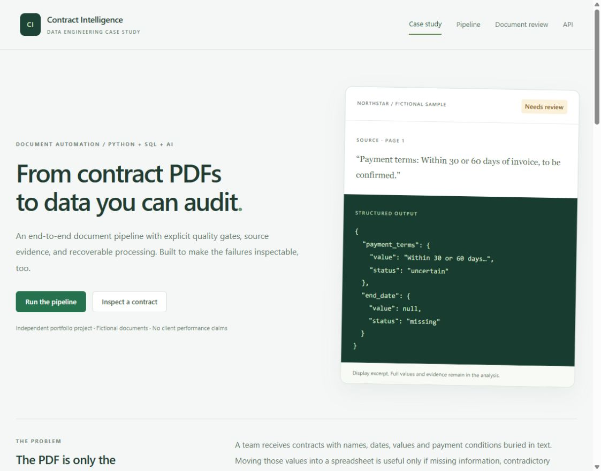

# From contract PDFs to auditable data

**Portfolio engineering case study.** Independent implementation using fictional documents. No employer code, customer documents or customer performance claims are included.

## Problem and service

Contract information arrives in PDFs but must become structured operational data. The useful task includes identifying missing or contradictory information, tracing values to the source, and recovering failed processing without duplicating successful results.

This project demonstrates receiving a batch, extracting typed fields, checking quality, persisting auditable output and delivering SQL-queryable data and review-ready exports. The app is a demonstration surface for that pipeline.

## Engineering decisions

- **Python and SQLite:** a clone-and-run local workflow without cloud accounts. Tables, foreign keys, transactions and views make the data model inspectable. SQLite is a single-machine scope choice, not evidence of distributed scalability.
- **Content and configuration identity:** SHA-256 identifies PDF bytes. Run fingerprints include pipeline version, mode, model, prompt/label hash, policy hash and synthetic-source flag. A successful matching run is reused; changed configurations create separate runs.
- **Separate stages:** original PDFs in `documents`; page text and typed extractor payload in `extraction_staging`; normalized fields, evidence and findings in separate tables.
- **Quality and execution:** a successfully processed contract can still require review. The accepted-data view includes supported fields only from contracts whose checks passed.
- **Recovery:** register all inputs before execution, claim runs with five-minute leases, fence commits with the active token, record attempts and stop after three attempts. Recovery is explicit through CLI/API, without a scheduler.
- **Human judgment:** absent values stay null. Uncertainty survives storage and export. Source matching does not establish legal validity or semantic completeness.

## Measured local baseline

The checked-in [report](../app/benchmark/local-report.json) evaluates **local rules**, using eight authored synthetic contracts and 88 manually specified field answers. The fixture builder never calls the extractor. [The frozen manifest](../app/benchmark/ground-truth.json) pins each PDF's hash.

| Metric | Observed count | Interpretation |
| --- | --- | --- |
| Field value exact match | 76 / 88 (86.4%) | Includes two correctly absent values |
| Non-null value precision | 74 / 75 (98.7%) | Correct non-null values / predicted non-null values |
| Non-null value recall | 74 / 86 (86.0%) | Correct non-null values / annotated non-null values |
| Field status match | 76 / 88 (86.4%) | Status against independent annotations |
| Annotated ambiguous/invalid issue recall | 7 / 7 | Only uncertain/invalid annotations; required missing fields are outside this denominator |
| Predicted-value quote grounding | 75 / 75 | Quote appears on its claimed page; not semantic correctness |
| False supported fields | 0 | Wrong/ungrounded values marked supported on this corpus |

Matching normalizes case and whitespace only; equivalent paraphrases count as mismatches. Counts, actual/expected values and field states remain in the report.

### Failures worth showing

- **Narrative wording:** all eleven fields in the prose-only agreement were missed. Required-field checks exposed the gaps.
- **Wrapped condition:** a payment clause lost its continuation. It counted as an incorrect value even though the baseline flagged uncertainty.
- **Bad source values:** negative amount, reversed dates and ambiguous currency remain invalid. Conflicting parties/payment terms remain uncertain.

The corpus is small, synthetic and visible during development. These are not unseen benchmark results, real-contract accuracy estimates or customer outcomes. Fixtures intentionally exercise implemented rules, so success cases can overstate generalization.

## Operational proof

The browser demo processes three fictional PDFs and writes 33 fields. One contract passes checks; two require review. Repeating the batch reuses all three successful runs without extra extraction attempts. Tests also exercise concurrent claims, stale-worker rejection, recovery and transactional rollback.

The CLI was also run over all eight PDFs: [first batch](pipeline-first-run.json), [replay](pipeline-replay.json), and [SQL summary](pipeline-summary.json). It produced 88 fields and replayed with eight cache hits and no extra attempts. Two contracts passed quality checks; six required review.

Failed normalized writes retain operational history and raw staging. Only the latest staging payload for a run is retained, while attempts preserve status/error history. Persistent storage is explicit in batch mode; individual review stays transient.

## AI boundary

The optional OpenAI adapter requests typed output, treats PDF content as untrusted data, handles provider failures and records returned token usage. Mocked tests verify adapter behavior. A paid live extraction has not been verified; model quality and monetary cost remain unmeasured.

The evaluation CLI accepts `--mode openai` when deliberately configured and identifies the mode/model in its report. An interruption after a provider call can incur another charge on retry even when SQL output is deduplicated.

## Present the project

1. Open `/case-study`: scenario, architecture and evaluation limits.
2. Open `/pipeline`: process the fictional batch and inspect quality outcomes.
3. Repeat the batch: unchanged run IDs and attempt counts, three reused results.
4. Open lineage: configuration, attempts, raw staging and normalized output.
5. Query accepted fields and quarantine with [SQL examples](queries.sql).
6. Export a saved result with uncertainty and evidence.
7. Open the evaluation JSON and show the narrative/wrapped-clause misses.

The repository gives a technical reviewer reproducible evidence; the interface makes it accessible to a nontechnical client.
